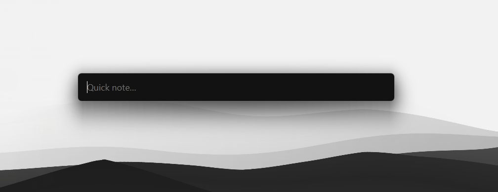

# Quicklly

A hotkey mini-notepad for Windows. Press a global hotkey anywhere, type a thought, hit
<kbd>Enter</kbd> — it is appended with a timestamp to today's markdown file, and you are
back in whatever you were doing.



- **Fast** — the input window pops up instantly on top of everything, already focused.
- **Plain text** — notes are ordinary `.md` files you can open in Obsidian or VS Code and sync
  with OneDrive or Git. No database.
- **Lightweight** — lives in the system tray.

## Installation

Download the installer (`Quicklly_x.y.z_x64-setup.exe`, or the `.msi`) from the
[latest release](https://github.com/ruslan1us/quicklly/releases/latest) and run it.
The installer is not code-signed yet, so Windows SmartScreen may warn you: click
**More info → Run anyway**.

## Usage

| Action                         | How                                         |
| ------------------------------ | ------------------------------------------- |
| Open the input window          | <kbd>Ctrl</kbd>+<kbd>Alt</kbd>+<kbd>N</kbd> (can be changed in the settings), or click the tray icon |
| Save the note                  | <kbd>Enter</kbd>                            |
| New line in the note           | <kbd>Shift</kbd>+<kbd>Enter</kbd>           |
| Paste an image                 | <kbd>Ctrl</kbd>+<kbd>V</kbd> with an image in the clipboard (also in the Pad); see [Reader](#reader) |
| Pick an existing tag           | Type `#` and the start of a tag; pick one with <kbd>↑</kbd> <kbd>↓</kbd> and <kbd>Enter</kbd> or <kbd>Tab</kbd>, <kbd>Esc</kbd> closes the list (also in the Pad) |
| Add a date                     | Type `/date` and press <kbd>Enter</kbd> to pick a day in the calendar, or `/date tomorrow` / `/date 15/10/2026`; see [Dates](#dates) (also in the Pad) |
| Previous / next saved note     | <kbd>↑</kbd> / <kbd>↓</kbd> in an empty field |
| Browse notes (see [Reader](#reader)) | <kbd>←</kbd> in an empty field        |
| Write a longer note in the Pad | <kbd>→</kbd> in an empty field, or `/pad`; <kbd>Ctrl</kbd>+<kbd>Enter</kbd> saves it as a note |
| Continue in the Pad            | <kbd>Ctrl</kbd>+<kbd>E</kbd> moves what you typed into the Pad; <kbd>←</kbd> in an empty Pad goes back |
| Search all notes               | Type `?` in an empty field, then a word; pick a result with <kbd>↑</kbd> <kbd>↓</kbd> and <kbd>Enter</kbd> to open it in the reader, <kbd>Backspace</kbd> on an empty search to leave |
| Cancel                         | <kbd>Esc</kbd>, or <kbd>Ctrl</kbd>+<kbd>C</kbd> when no text is selected |
| Dismiss, keeping the draft     | Click anywhere outside the window           |
| Open the notes folder          | Tray menu → **Open notes folder**           |
| Settings                       | Type `/config` and press <kbd>Enter</kbd>, or tray menu → **Settings…** |
| Help and version               | Type `/help` and press <kbd>Enter</kbd>    |
| What's new                     | Type `/changelog` and press <kbd>Enter</kbd> (see [CHANGELOG.md](CHANGELOG.md)) |
| Notes due                      | Type `/reminders` and press <kbd>Enter</kbd>; see [Reminders](#reminders) |
| Update                         | When a new version is out, the hint says so for two seconds; type `/update` and press <kbd>Enter</kbd> to install it now. Otherwise it is downloaded in the background and installed on the next start (unless **Auto update** is off in the settings) |
| Exit                           | Type `/exit` and press <kbd>Enter</kbd>, or tray menu → **Quit** |

## Where notes are stored

Each day gets its own file in `%USERPROFILE%\Documents\Quicklly\`:

```
Quicklly/
  2026-09-26.md
  2026-09-27.md
```

A file looks like this:

```markdown
# 2026-09-26

- 14:32 check why swap keeps growing on prod3
- 15:10 buy a birthday present
- 18:45 coffee tracker in the tray #idea
```

Files are UTF-8; new notes are appended to the end, and the heading is written with the first
note of the day. A multi-line note stays one list item, with the extra lines indented under it:

```markdown
- 19:20 groceries:
  milk
  bread
```

Alternatively, choose **Single inbox** in the settings to keep all notes in one `inbox.md`,
grouped by day:

```markdown
# Inbox

## 2026-09-26

- 14:32 check why swap keeps growing on prod3
- 15:10 buy a birthday present

## 2026-09-27

- 09:05 book a dentist appointment
```

A note with a `#tag` goes to the file of that tag instead: `buy milk #todo` is appended to
`todo.md`, grouped by day like the inbox. The tag stays in the note; with several tags, the
first one decides. A tag starts with a letter, so `#1` or `C#` are not tags.

Tags can be nested with `/`: `#work/quicklly` goes to `work/quicklly.md`, in a `work` folder
of the notes folder (created when needed), at any depth. Images in such a note are linked from
that folder (`../images/…`), so Obsidian shows them. The reader sorted by name shows the folders
as a tree. `archive` and `images` are the app's own folders, so `#archive/x` and `#images/x` are
just `#archive` and `#images`.

The notes folder can be changed in the settings as well.

### Dates

Type `/date` anywhere in a note (in the input window or the Pad) and press <kbd>Enter</kbd>: a
calendar opens on today. <kbd>←</kbd> <kbd>→</kbd> move by a day, <kbd>↑</kbd> <kbd>↓</kbd> by a
week, <kbd>PgUp</kbd> <kbd>PgDn</kbd> by a month, <kbd>Enter</kbd> picks the day and
<kbd>Esc</kbd> closes the calendar. `/date tomorrow` or `/date 15/10/2026` (in your date format)
puts the date in straight away. Either way `/date` is replaced by the date, `📅 15/10/2026`, and
you go on typing; the next <kbd>Enter</kbd> saves the note. One <kbd>Backspace</kbd> right after
a date removes all of it. Files keep the date as
`📅 2026-10-15`, the due date of [Obsidian Tasks](https://publish.obsidian.md/tasks/); the input
window, the Pad and the reader show it in the **Date format** of the settings.

### Reminders

Notes that are not done and have a date of today or earlier pop up in a small window in the
bottom right corner when Quicklly starts (also with Windows) and when a new day begins while it
runs: overdue ones first, then today's. The window stays on top without taking the focus, so it
doesn't get in the way of your typing; click it to use the keys. <kbd>↑</kbd> <kbd>↓</kbd> select
a note, <kbd>Space</kbd> marks it done (and takes it off the list), <kbd>Enter</kbd> opens it in
the [reader](#reader) and <kbd>Esc</kbd> closes the window; it closes by itself once everything
is done. `/reminders` in the input window opens it at any time.

### Archive

Marking a note done adds the day it was done to the file, `✅ 2026-10-13`, the done date of
[Obsidian Tasks](https://publish.obsidian.md/tasks/); marking it not done again takes it off.
The reader doesn't show that date, but how long the note has left, like `archive in 3 days`.
After a while (7 days, see **Archive done notes** in the
settings) done notes move out of their file into the same file in an `archive` folder in the
notes folder: `todo.md` → `archive/todo.md`, `2026-10-08.md` → `archive/2026-10-08.md`, grouped
by day like the original. This happens when Quicklly starts, when a new day begins and when the
setting is changed. The reader, the search and the reminders don't show the archive. Notes marked
done before this version have no done date, so they stay where they are.

## Reader

Press <kbd>←</kbd> in an empty input window to browse your notes. The first screen lists the
notes files, either the one changed last first or by name (the
inbox, tag files and any other Markdown files in the folder, then the days, newest first, then
each folder with its files the same way), each with a progress bar of done notes; a file where every note is
done is crossed off. Open one to go through its notes one by one (a multi-line note is one
entry):

| Key                                  | Files                  | Notes                              |
| ------------------------------------ | ---------------------- | ---------------------------------- |
| <kbd>↑</kbd> <kbd>↓</kbd>            | Select a file          | Select a note                      |
| <kbd>Enter</kbd>                     | Open the file          | Edit the note                      |
| <kbd>Tab</kbd>                       | Sort: recent first / by name |                              |
| <kbd>Shift</kbd>+<kbd>Enter</kbd>    |                        | Edit the note in the Pad           |
| <kbd>Space</kbd>                     |                        | Mark as done / not done            |
| <kbd>C</kbd>                         |                        | Copy the note's links              |
| <kbd>O</kbd>                         |                        | Open the note's images             |
| <kbd>Del</kbd>                       | Move to the Recycle Bin (press <kbd>Del</kbd> twice) | Delete (press <kbd>Del</kbd> twice) |
| <kbd>Ctrl</kbd>+<kbd>P</kbd>         |                        | Pin: keep the reader open over other windows, resizable and up to date |
| <kbd>←</kbd>                         |                        | Back to the files                  |
| <kbd>→</kbd>                         | Back to the input      |                                    |
| <kbd>Esc</kbd>, <kbd>Ctrl</kbd>+<kbd>C</kbd> | Close          | Close                              |

A done note is stored as a Markdown task, which Obsidian shows as a checked box, with the day it
was done (see [Archive](#archive)):

```markdown
- [x] 15:10 buy a birthday present ✅ 2026-09-27
```

Changes only touch that note; the rest of the file stays as it is. If the file was changed
elsewhere in the meantime, nothing is written and the reader reloads it.

Links (`https://…`, or just a domain like `google.com` or `github.com/ruslan1us`) are
underlined as you type, in the input window and in the Pad. The reader and the search results show them short, without the protocol
and with only the start of the path (`https://github.com/ruslan1us/quicklly/releases` →
`github.com/rusl...`); the file keeps the whole link, and <kbd>C</kbd> copies the selected
note's links, one per line.

To add a screenshot or any other image, copy it and paste it with <kbd>Ctrl</kbd>+<kbd>V</kbd> in
the input window or the Pad: it shows as `[Image #1]` (then `[Image #2]`, …) and is saved right
away in an `images` folder next to the notes. The note gets a Markdown image instead of the
label, ``, so Obsidian shows the picture; the reader
shows the label again, and <kbd>O</kbd> opens the selected note's images in the default viewer.
Deleting a note or a notes file in the reader, or taking an image out of a note, moves its images
to the Recycle Bin too, unless another note still links to them.

## Pad

For longer notes there is the Pad: a bigger editor with line numbers. Open it with <kbd>→</kbd>
in an empty input window or `/pad`, or press <kbd>Ctrl</kbd>+<kbd>E</kbd> to carry on there with
what you already typed. It pops up in the top right corner (see **Pad position** in the settings),
or opens straight away with the hotkey if **Hotkey opens** is set to **Pad**.

| Key                                  | Action                                                   |
| ------------------------------------ | -------------------------------------------------------- |
| <kbd>Ctrl</kbd>+<kbd>Enter</kbd>     | Save the text as a note and start over                   |
| <kbd>Enter</kbd>                     | New line; in a list (`- `, `- [ ] `, `1. `) the next item |
| <kbd>Tab</kbd> / <kbd>Shift</kbd>+<kbd>Tab</kbd> | Indent / outdent                             |
| <kbd>Ctrl</kbd>+<kbd>P</kbd>         | Pin: keep the Pad open over other windows, movable and resizable |
| <kbd>←</kbd> in an empty Pad         | Back to the input window                                 |
| <kbd>Esc</kbd>, <kbd>Ctrl</kbd>+<kbd>C</kbd> | Close; the draft is kept, even across restarts   |

A note saved from the Pad keeps its blank lines and indentation. `#tags` and checkboxes are
highlighted as you type. In the [reader](#reader), <kbd>Shift</kbd>+<kbd>Enter</kbd> opens a note in
the Pad to edit it there.

## Settings

Open the settings with `/config` in the input window or from the tray menu. They are fully
keyboard-driven:

| Key                                  | Action                                     |
| ------------------------------------ | ------------------------------------------ |
| <kbd>↑</kbd> <kbd>↓</kbd>            | Select a setting                           |
| <kbd>←</kbd> <kbd>→</kbd>            | Switch between values                      |
| <kbd>Enter</kbd>                     | Edit: record a new hotkey, pick a folder   |
| <kbd>Del</kbd>                       | Reset the setting to its default           |
| <kbd>Esc</kbd>, <kbd>Ctrl</kbd>+<kbd>C</kbd> | Close                              |

| Setting            | Default                                     | Options                                      |
| ------------------ | ------------------------------------------- | -------------------------------------------- |
| Hotkey             | <kbd>Ctrl</kbd>+<kbd>Alt</kbd>+<kbd>N</kbd> | Any key or combination except <kbd>Esc</kbd> |
| Hotkey opens       | Quick line                                  | Quick line, Pad                              |
| Pad position       | Top right                                   | Top right, Top left, Bottom right, Bottom left, Center |
| Notes folder       | `%USERPROFILE%\Documents\Quicklly`          | Any folder                                   |
| Notes file         | One file per day                            | One file per day, or a single `inbox.md`     |
| Date format        | DD/MM/YYYY                                  | DD/MM/YYYY, MM/DD/YYYY, YYYY-MM-DD, DD.MM.YYYY: how `/date` dates are typed and shown |
| Archive done notes | After 7 days                                | Never, after 1, 3, 7, 14 or 30 days: when done notes move to `archive/` (see [Archive](#archive)) |
| Theme              | Default                                     | Default (dark), Default+ (dark purple), Light |
| Transparency       | 30%                                         | Off to 80%: how much of the blurred desktop shows through the windows |
| Scale              | 100%                                        | 80% to 150%                                  |
| Start with Windows | Off                                         | On, Off                                      |
| Auto update        | On                                          | On, Off (`/update` works either way)         |

## Building from source

Prerequisites (on Windows):

- [Node.js](https://nodejs.org/) LTS
- [Rust](https://rustup.rs/) (stable, MSVC toolchain)
- [Microsoft C++ Build Tools](https://visualstudio.microsoft.com/visual-cpp-build-tools/)
  with the Windows SDK
- WebView2 (preinstalled on Windows 10/11)

See the [Tauri prerequisites](https://tauri.app/start/prerequisites/) for details.

```sh
npm install
npm run tauri dev     # run in development mode
npm run tauri build   # build the installer into src-tauri/target/release/bundle/
npm test              # run the frontend tests
```

The Rust tests run with `cargo test` in `src-tauri/`.

## License

[MIT](LICENSE)
