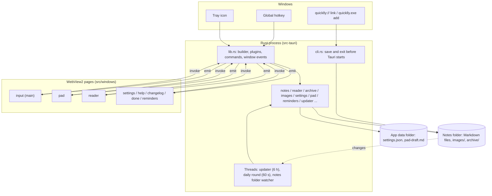

# Architecture

Quicklly is a Tauri 2 application: one Rust process that owns the tray icon, the global hotkey,
the file system and every window, and one WebView2 page per window that renders the UI in
TypeScript. Pages call Rust through IPC commands and Rust notifies pages through events. Note
content is never cached: every view reads the Markdown files again when it needs them. This page
describes the process model, the windows and their life cycle, the IPC surface, managed state,
background threads and the start-up paths (normal start, second instance, command line and deep
link, update).

## Overview

## Process model

- **One Rust process.** [`main.rs`](../src-tauri/src/main.rs) calls `quicklly_lib::run()` in
  [`lib.rs`](../src-tauri/src/lib.rs). The release binary uses the Windows GUI subsystem, so it has
  no console window.
- **Command line first.** Before the Tauri builder is created, `run()` checks the arguments with
  `cli::note_request`. A `quicklly add …` or `quicklly://add?…` invocation saves the note in that
  process and exits with its status code; Tauri never starts. See [CLI and links](cli-and-links.md)
  and [ADR 0007](decisions/0007-cli-handled-in-a-fresh-process-before-tauri-starts.md).
- **Plugins**, in registration order: `single-instance` (must be first), `deep-link`, `opener`,
  `store`, `dialog`, `autostart`, `updater`, `global-shortcut`.
- **Set-up** (`.setup`): in debug builds the `quicklly://` scheme is registered for the dev binary
  (installers register it for release builds); then the tray is built, the saved hotkey is
  registered, the updater thread starts, the Pad and reader pin states are loaded, the acrylic
  effect is applied to the input window, the scale setting is applied, the daily-round thread
  starts, and the notes folder starts being watched.
- **The app lives in the tray.** No window is visible at start. Closing a window never quits the
  application; only the tray's **Quit** or `/exit` does (`app.exit(0)`).

## Windows

Each window is a page `src/windows/<name>/index.html`, built to `dist/windows/<name>/index.html`
and addressed from Rust with `page(name)` in [`lib.rs`](../src-tauri/src/lib.rs). All windows are
frameless, always on top, absent from the taskbar, transparent with an acrylic blur behind them,
and zoomed to the scale setting.

| Label | Page | Created | When dismissed | Opened by |
| --- | --- | --- | --- | --- |
| `main` | `input` | At start from `tauri.conf.json`, hidden, unfocused | Hidden (focus loss, <kbd>Esc</kbd>, Alt+F4) | Hotkey, tray click, tray **New note**, second launch, `open_input` |
| `pad` | `pad` | Lazily by `pad::show` | Hidden; a pinned Pad stays on focus loss | Hotkey (when set to Pad), `open_pad`, `expand_to_pad`, `edit_in_pad` |
| `reader` | `reader` | Lazily by `show_popup` | Closed (destroyed); on focus loss only when unpinned and visible | `open_reader`, `open_note` |
| `settings` | `settings` | Lazily by `show_popup` | Closed | `/config`, tray **Settings…** |
| `help` | `help` | Lazily by `show_popup` | Closed | `/help` |
| `changelog` | `changelog` | Lazily by `show_popup` | Closed | `/changelog` |
| `done` | `done` | Lazily by `show_popup` | Closed | `/done` |
| `reminders` | `reminders` | Lazily by `reminders::show` | Closed | Daily round, `/reminders` |

### Creation rules

- **Lazily, from async commands.** A window other than `main` is created the first time it is
  needed, so it costs nothing until then. Every command that may create a window is `async`:
  creating a window from a synchronous command deadlocks on Windows. Windows are also created from
  the tray menu, the hotkey handler (the Pad) and the daily-round thread (the reminders). See
  [ADR 0008](decisions/0008-windows-created-lazily-from-async-commands.md).
- **Hidden first, then revealed by the page.** Windows are built with `visible(false)`. The page
  applies the theme, loads its data, sizes the window to its content and only then shows it, so it
  never flickers at the wrong size. Popups call `reveal()` from
  [`popup.ts`](../src/shared/popup.ts) (centre on the active monitor, show, focus); the reminders
  call `reveal_reminders`; the Pad and a pinned reader show themselves.
- **Unfocused creation.** `show_popup` and the reminders build windows with `focused(false)`, and
  the `main` window is declared with `"focus": false`. A hidden window created with focus would
  take the keyboard from the application in use, notably at start.
- **Focus-loss rules.** In `on_window_event`: the input window hides on focus loss (the typed text
  stays); the Pad hides on focus loss unless pinned; the reader closes on focus loss only when
  unpinned and already visible, because Windows may report a focus loss while the window is still
  being set up hidden. Other popups stay open until dismissed. `CloseRequested` on `main` and `pad`
  is turned into a hide.
- **One window at a time.** When one window opens another (input to reader, reader to input,
  reminders to reader), the page hides itself before invoking the command, so two windows never
  show at once.
- **Placement.** [`monitor.rs`](../src-tauri/src/monitor.rs) picks the monitor of the foreground
  window, then the one under the mouse, then the primary one. The input window and popups are
  centred on it; the Pad goes to the corner from the settings; the reminders go to the bottom-right
  corner. Pinned Pad and reader windows restore their saved bounds
  ([`window_bounds.rs`](../src-tauri/src/window_bounds.rs)).
- **Permissions.** Every window label is listed in
  [`capabilities/default.json`](../src-tauri/capabilities/default.json), which grants the core
  window permissions the pages use (show, hide, close, focus, size, centre, drag). Application
  commands need no capability entry.

## IPC commands

Commands are registered in `generate_handler!` in [`lib.rs`](../src-tauri/src/lib.rs). Argument
names are camelCase on the JavaScript side (Tauri's default). Commands that read or change notes
resolve the notes folder through `settings::notes_dir` on every call. Commands marked *async*
create or may create a window.

| Command | Module | Used by | Purpose |
| --- | --- | --- | --- |
| `save_note(text)` | lib | input, Pad | Append a note; emits `notes-changed` |
| `save_image(raw body)` | lib | input, Pad | Save a pasted image (MIME type in the `Image-Type` header); returns `images/…` |
| `open_images(name, paths)` | lib | reader | Open a note's images in the default viewer |
| `search_notes(query)` | lib | input | Up to 50 matching notes, newest first |
| `list_note_files` | lib | reader | Notes files with counts and modification times |
| `list_tags` | lib | input, Pad | Tags that have a file, for suggestions |
| `read_note_file(name)` | lib | reader | Parsed day headings and notes of one file |
| `set_note_done(name, note, done)` | lib | reader, reminders | Toggle done; returns a `Change` |
| `edit_note(name, note, text)` | lib | reader, Pad | Replace a note's text; returns a `Change` |
| `delete_note(name, note)` | lib | reader | Delete a note; returns a `Change` |
| `undo_change(name, change)` | lib | reader | Restore the file before a `Change` and its images |
| `delete_note_file(name)` | lib | reader | Move a notes file and its unused images to the Recycle Bin |
| `snooze_note(name, note, days)` | lib | reminders | Move a note's due date to today plus `days` |
| `list_done` | lib | done | Notes done in the last 7 days, archive included |
| `open_note(file, line)` *async* | lib | input, reminders | Open the reader on a note |
| `take_reader_target` | lib | reader | Take the pending note to open |
| `open_input` | lib | reader, Pad | Show the input window |
| `open_reader`, `open_settings`, `open_help`, `open_changelog`, `open_done` *async* | lib | input | Open a popup |
| `exit_app` *async* | lib | input | Quit |
| `open_reminders` *async* | reminders | input | Open focused; returns `false` when nothing is due or ahead |
| `list_due(ahead)` | reminders | reminders | Notes due today or earlier, or ahead |
| `reveal_reminders`, `place_reminders` | reminders | reminders | Show in the corner; keep the corner after a resize |
| `open_pad`, `expand_to_pad(text)`, `edit_in_pad(name, note)` *async* | pad | input, reader | Open the Pad, append text to its draft, or edit a note in it |
| `get_pad_draft`, `set_pad_draft(text)`, `take_pad_edit` | pad | Pad | Draft persistence and the pending edit |
| `get_pad_pinned`, `set_pad_pinned(pinned)` | pad | Pad | Pin state |
| `get_reader_pin`, `set_reader_pin(pinned, file)`, `get_reader_sort`, `set_reader_sort(sort)` | reader_window | reader | Pin state, pinned file, sort order |
| `center_window` | monitor | popups via `reveal()` | Centre the calling window on the active monitor |
| `get_update`, `install_update` *async* | updater | input | The waiting release; `/update` |
| `get_appearance` | settings | every page | Theme, transparency, scale |
| `get_date_format` | settings | pages that show dates | Date format |
| `get_archive_days` | settings | reader, help | Days until a done note is archived |
| `get_settings`, `pick_notes_dir` *async*, `reset_notes_dir`, `set_mode`, `set_hotkey`, `reset_hotkey`, `set_hotkey_target`, `set_pad_position`, `set_date_format`, `set_archive_after`, `set_theme`, `set_transparency`, `set_scale`, `set_autostart`, `set_auto_update` | settings | settings | Read and change settings; each returns the full settings view |

## Events

| Event | Payload | Target | Emitted when | Listener |
| --- | --- | --- | --- | --- |
| `notes-changed` | none | `reader`, `reminders`, `done` | A command changed a notes file; the archive moved notes; a new day while the reminders are open; the folder watcher saw a notes file change (the CLI, another editor, and a second time for the app's own writes) | Reader reloads unless editing; reminders and done reload |
| `appearance-changed` | `{ theme, transparency, scale }` | all | Theme, transparency or scale changed | `followTheme` in [`theme.ts`](../src/shared/theme.ts) |
| `date-format-changed` | format string | all | Date format changed | `followDateFormat` in [`dates.ts`](../src/shared/dates.ts) |
| `update-available` | version or `null` | all | A release was downloaded; `null` when automatic updates are turned off | Input window hint |
| `reader-target` | none | `reader` | `open_note` while the reader exists | Reader takes the target |
| `pad-edit` | none | `pad` | `edit_in_pad` while the Pad exists | Pad takes the edit |
| `pad-draft-changed` | none | `pad` | `expand_to_pad` while the Pad exists | Pad reloads the draft |

Events that carry a request (`reader-target`, `pad-edit`) have no payload: the request is stored
in managed state and taken by the page with a command. The same command serves a freshly created
window, which takes the request once it has loaded, so the hand-over works whether or not the
window existed.

## Managed state

| Type | Module | Holds |
| --- | --- | --- |
| `PendingReaderTarget` | lib | The note the reader should open next (file and line) |
| `pad::PendingEdit` | pad | The reader note the Pad should edit next |
| `pad::Pinned`, `reader_window::Pinned` | pad, reader_window | Pin state, loaded from the store at start and read by window-event handlers without touching the store |
| `updater::AvailableUpdate` | updater | Version of a downloaded release |
| `reminders::FocusOnShow` | reminders | Whether the reminders window takes focus when revealed |
| `watcher::Watcher` | watcher | The watcher of the notes folder; replaced when the folder changes |

Persistent settings live in `settings.json` through `tauri-plugin-store`; see
[Data format](data-format.md#application-files) and
[ADR 0012](decisions/0012-settings-in-tauri-plugin-store.md).

## Background threads

| Thread | Module | Interval | Work |
| --- | --- | --- | --- |
| Updater | [`updater.rs`](../src-tauri/src/updater.rs) | At start, then every 6 hours | When automatic updates are on: look for a release, download and verify it, announce it; at start, install a release downloaded earlier |
| Daily round | [`reminders.rs`](../src-tauri/src/reminders.rs) | Checks the date every 60 seconds | At start and whenever the local date changes (midnight, or waking on a later day): archive done notes, then show the reminders unfocused if anything is due |
| Notes folder watcher | [`watcher.rs`](../src-tauri/src/watcher.rs) | On file system events, debounced by 300 ms | Started at start and again when the notes folder changes in settings: watches the folder recursively and emits `notes-changed` when a `.md` file changes (not `*.md.tmp`, `images/` or dot-folders). See [ADR 0017](decisions/0017-watch-the-notes-folder-for-changes.md) |

## Single instance

`tauri-plugin-single-instance` is registered first. A second launch without a note request exits
inside the plugin and the running instance shows its input window. A launch with a note request
never reaches the plugin: the CLI path saves and exits earlier.

## Tray and hotkey

The tray ([`lib.rs`](../src-tauri/src/lib.rs) `setup_tray`) shows the input window on a left
click and offers **New note**, **Open notes folder**, **Settings…** and **Quit**. The global
shortcut plugin has a single handler for the single registered shortcut; on press it opens the
input window or the Pad according to the **Hotkey opens** setting. Hotkey parsing and labels are in
[`hotkey.rs`](../src-tauri/src/hotkey.rs); registration and changes are in
[`settings.rs`](../src-tauri/src/settings.rs). A hotkey that cannot be registered at start is
logged and the tray keeps working; a new hotkey that cannot be registered is rejected and the old
one is registered again.

## Updates

Releases are signed and published on GitHub; the updater plugin reads
`releases/latest/download/latest.json` and verifies signatures with the public key in
[`tauri.conf.json`](../src-tauri/tauri.conf.json). A running instance downloads a newer release in
the background to the app cache directory (`update-<version>.bin`) and announces it with
`update-available`; the next start installs it (the NSIS installer in passive mode, which exits
and restarts the app). `/update` installs immediately. See [Release](release.md) and
[ADR 0013](decisions/0013-signed-auto-updates-via-github-releases.md).

## Known limitations

- Files are not locked. A note saved by the CLI process, or a hand edit, can race with a change
  made in the application; edits are protected by the "unchanged since shown" checks described in
  [Backend](backend.md#changes-to-existing-notes), appends are not.
- Changes made outside the application (the CLI process, another editor) reach open windows
  through the notes folder watcher, about 300 ms after the last write. The app's own writes are
  seen by it too, so the windows reload a second time after them. Renaming or moving a whole
  folder is reported for the folder only and does not count as a change to its notes files.
- The daily round checks the date once a minute, so the reminders can appear up to a minute after
  midnight or after waking.
