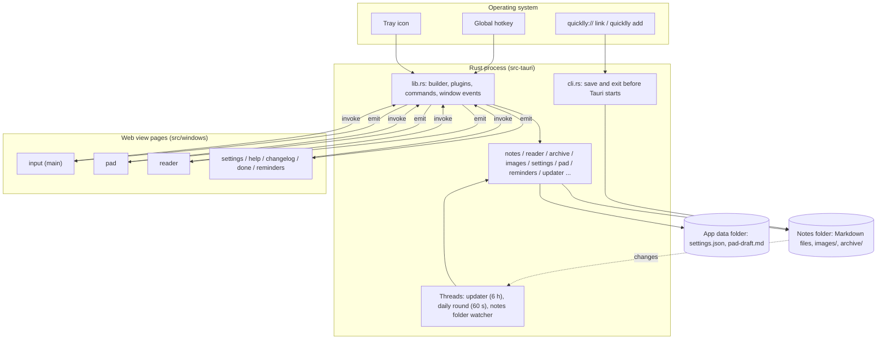

# Architecture

Quicklly is a Tauri 2 application: one Rust process that owns the tray icon, the global hotkey,
the file system and every window, and one web page per window that renders the UI in TypeScript,
in the system's web view: WebView2 on Windows, WKWebView on macOS, WebKitGTK on Linux. Pages call
Rust through IPC commands and Rust notifies pages through events. Note content is never cached:
every view reads the Markdown files again when it needs them. This page describes the process
model, the windows and their life cycle, the IPC surface, managed state, background threads and
the start-up paths (normal start, second instance, command line and deep
link, update).

## Overview

## Process model

- **One Rust process.** [`main.rs`](../src-tauri/src/main.rs) calls `quicklly_lib::run()` in
  [`lib.rs`](../src-tauri/src/lib.rs). On Windows the release binary uses the GUI subsystem, so it
  has no console window.
- **Command line first.** Before the Tauri builder is created, `run()` checks the arguments with
  `cli::note_request`. A `quicklly add …` or `quicklly://add?…` invocation saves the note in that
  process and exits with its status code; Tauri never starts. See [CLI and links](cli-and-links.md)
  and [ADR 0007](decisions/0007-cli-handled-in-a-fresh-process-before-tauri-starts.md). macOS
  never starts a process for a link: it hands the link to the running app, which saves it
  ([ADR 0019](decisions/0019-links-saved-by-the-running-app-on-macos.md)).
- **Plugins**, in registration order: `single-instance` (must be first), `deep-link`, `opener`,
  `store`, `dialog`, `autostart`, `updater`, `global-shortcut` (not on Wayland, see
  [Tray and hotkey](#tray-and-hotkey)).
- **Set-up** (`.setup`): the `quicklly://` scheme is registered for the running binary in Windows
  debug builds (installers register it for release builds) and in every Linux build (see
  [CLI and links](cli-and-links.md#registration-of-the-scheme)); on macOS the app starts listening
  for opened `quicklly://` links and saves the one it was started with, if any
  ([Links on macOS](cli-and-links.md#links-on-macos)); then the tray is built, the
  saved hotkey is registered, the updater thread starts, the Pad and reader pin states are loaded,
  the blur effect is applied to the input window, the scale setting is applied, the daily-round
  thread starts, and the notes folder starts being watched. On macOS set-up ends with
  `give_focus_back` (see [Focus on macOS](#focus-on-macos)): macOS makes an app active to launch
  it, and Quicklly has no window to show then.
- **The app lives in the tray.** No window is visible at start. Closing a window never quits the
  application; only the tray's **Quit** or `/exit` does (`app.exit(0)`).
- **A menu-bar app on macOS.** `skipTaskbar` does nothing there, so `run()` sets the activation
  policy to `Accessory`: no Dock icon and no entry in ⌘-Tab, only the icon in the menu bar. It is
  set on the built app before it runs, not in set-up: tao applies its own policy (`Regular`, over
  the bundle's `LSUIElement`) when the app has launched, before set-up, so a change in set-up
  would come after the Dock icon and the menu bar had shown for a moment.
- **Run events.** `run()` builds the app and runs it with `on_run_event`, which does nothing on
  Windows and Linux; on macOS it handles `RunEvent::Reopen` (see
  [Single instance](#single-instance)).

## Windows

Each window is a page `src/windows/<name>/index.html`, built to `dist/windows/<name>/index.html`
and addressed from Rust with `page(name)` in [`lib.rs`](../src-tauri/src/lib.rs). All windows are
frameless, always on top, absent from the taskbar, transparent with a blur behind them, and
zoomed to the scale setting. The blur is `blur_behind()` in [`lib.rs`](../src-tauri/src/lib.rs):
Acrylic on Windows; on macOS, where Acrylic doesn't exist, the `HudWindow` vibrancy (always dark),
kept active while the window doesn't have the focus so that it doesn't turn grey. Linux has no
blur: Tauri can't apply window effects there, so the windows are transparent over the plain
desktop.

Transparent windows need macOS's private API: on macOS, Tauri's `transparent()` builder method
exists only with the `macos-private-api` feature of the `tauri` crate, so without it the app does
not compile there. The feature is on in [`Cargo.toml`](../src-tauri/Cargo.toml) together with
`app.macOSPrivateApi: true` in [`tauri.conf.json`](../src-tauri/tauri.conf.json); the two must
agree (the Tauri build script checks this, and the Tauri CLI rewrites the feature to match the
config), so the flag lives in the base config, not a macOS-only one. On Windows and Linux both are
no-ops. The private API keeps an app out of Apple's App Store, which Quicklly does not use.

| Label | Page | Created | When dismissed | Opened by |
| --- | --- | --- | --- | --- |
| `main` | `input` | At start from `tauri.conf.json`, hidden, unfocused | Hidden (focus loss, <kbd>Esc</kbd>, Alt+F4) | Hotkey, tray click, tray **New note**, second launch, `open_input` |
| `pad` | `pad` | Lazily by `pad::show` | Hidden; a pinned Pad stays on focus loss | Hotkey (when set to Pad; on Wayland also a second launch), `open_pad`, `expand_to_pad`, `edit_in_pad` |
| `reader` | `reader` | Lazily by `show_popup` | Closed (destroyed); on focus loss only when unpinned and visible | `open_reader`, `open_note` |
| `settings` | `settings` | Lazily by `show_popup` | Closed | `/config`, tray **Settings…** |
| `help` | `help` | Lazily by `show_popup` | Closed | `/help` |
| `changelog` | `changelog` | Lazily by `show_popup` | Closed | `/changelog` |
| `done` | `done` | Lazily by `show_popup` | Closed | `/done` |
| `reminders` | `reminders` | Lazily by `reminders::show` | Closed | Daily round, `/reminders` |

### Creation rules

- **Lazily, from async commands.** A window other than `main` is created the first time it is
  needed, so it costs nothing until then. Every command that may create a window is `async`:
  creating a window from a synchronous command deadlocks on Windows. Windows are also created from
  the tray menu, the hotkey handler (the Pad) and the daily-round thread (the reminders). See
  [ADR 0008](decisions/0008-windows-created-lazily-from-async-commands.md).
- **Hidden first, then revealed by the page.** Windows are built with `visible(false)`. The page
  applies the theme, loads its data, sizes the window to its content and only then shows it, so it
  never flickers at the wrong size. Popups call `reveal()` from
  [`popup.ts`](../src/shared/popup.ts) (centre on the active monitor with `center_window`, then
  show and focus with `reveal_window`); the reminders call `reveal_reminders`; the Pad and a pinned
  reader call `reveal_window` themselves.
- **Unfocused creation.** `show_popup` and the reminders build windows with `focused(false)`, and
  the `main` window is declared with `"focus": false`. A hidden window created with focus would
  take the keyboard from the application in use, notably at start.
- **Focus-loss rules.** In `on_window_event`: the input window hides on focus loss (the typed text
  stays); the Pad hides on focus loss unless pinned; the reader closes on focus loss only when
  unpinned and already visible, because Windows may report a focus loss while the window is still
  being set up hidden. Other popups stay open until dismissed. `CloseRequested` on `main` and `pad`
  is turned into a hide.
- **One window at a time.** When one window opens another (input to reader, reader to input,
  reminders to reader), the page hides itself before invoking the command, so two windows never
  show at once.
- **Placement.** [`monitor.rs`](../src-tauri/src/monitor.rs) picks the monitor of the foreground
  window, then the one under the mouse, then the primary one. The input window and popups are
  centred on it; the Pad goes to the corner from the settings; the reminders go to the bottom-right
  corner. Pinned Pad and reader windows restore their saved bounds
  ([`window_bounds.rs`](../src-tauri/src/window_bounds.rs)), but only the size when the top
  32 pixels of the saved rectangle are on no current monitor (a monitor was disconnected or
  rearranged); the window then gets the place it would get with nothing saved.
- **Spaces on macOS.** Every window is on all Spaces (`visible_on_all_workspaces`, through
  `ON_EVERY_SPACE` in the builders and set on `main` at set-up), so a window shows on the Space in
  use and a pinned Pad or reader comes along when the user switches Spaces, instead of macOS
  switching back to the Space where the window was. Windows has no such option, and on Linux the
  flag would stick the windows to every workspace, so it is off there. The windows still can't
  show over another app's full-screen Space.
- **No minimising or full screen on macOS.** Tauri gives a macOS app the default menu bar menu,
  whose Edit menu makes ⌘C, ⌘V, ⌘X, ⌘A and ⌘Z work in the text fields, but whose Window and View
  menus would also minimise the window with the keys into the Dock (⌘M), where a menu-bar app has
  no icon to bring it back from, or put it in full screen (⌃⌘F). `no_minimize_or_full_screen` in
  [`lib.rs`](../src-tauri/src/lib.rs) therefore makes every window not minimisable and gives it
  the `FullScreenNone` collection behaviour, right after it is built (the input window at set-up).
  On Windows and Linux it does nothing: the windows stay as they were there.
- **Permissions.** Every window label is listed in
  [`capabilities/default.json`](../src-tauri/capabilities/default.json), which grants the core
  window permissions the pages use (show, hide, close, focus, size, centre, drag). Application
  commands need no capability entry.

### Focus on macOS

On Windows, hiding Quicklly's last window gives the keyboard back to the application in use
before. macOS leaves Quicklly the active application with no window, so typing goes nowhere until
the user clicks somewhere. Quicklly therefore hides itself (`app.hide()`), and macOS activates the
previous application:

- **When.** `give_focus_back` in [`lib.rs`](../src-tauri/src/lib.rs) runs on every
  `Focused(false)` and `Destroyed` window event, at the end of set-up, and after a
  [link](cli-and-links.md#links-on-macos) is saved. It decides 250 ms later (`HAND_OVER`), on the main thread, and hides the app when no
  window is visible and no popup exists then. Popups are closed when they are done, so one that
  exists hidden is still being set up and about to show (the reminders open the reader and close
  themselves, for example); the input window and the Pad live hidden and count only when visible,
  and so do the reminders that come up by themselves, which show without the app being active.
  A visible pinned Pad or reader keeps Quicklly from hiding, since hiding the app would hide them
  too.
- **Hand-overs.** When the input window or the Pad hands over to another window (the reader,
  settings, help, the Pad, the input window), it hides first and then asks for the other one.
  The wait gives that window time to exist (a popup) or to show (the input window, a Pad that
  existed), so the app stays active throughout and keys typed meanwhile stay in Quicklly. The
  price: after the last window goes, the previous application gets the keyboard back 250 ms
  later. A Pad opened for the first time takes longer to load than the wait, so Quicklly may still
  hide and come forward again then, and the previous application flash as active.
- **Coming back.** The windows of a hidden app don't show, and `set_focus` does nothing for them.
  Every path that shows a window with the focus therefore calls `come_forward` first, which
  unhides the app (`app.show()`, which activates it): `show_input`, `show_popup`, `pad::show`,
  `expand_to_pad` (whose failure brings the input window back), the reminders when asked for,
  and `reveal_window`, through which the pages show themselves once they are ready (a popup's
  `reveal()`, the Pad, a pinned reader), so a window always shows even when the app hid while it
  was being set up. The reminders that come up by themselves unhide the app without activating
  it and are ordered in without becoming the key window (`orderFrontRegardless`), so they don't
  take the keyboard, neither from another app nor from a Quicklly window being typed in. On
  Windows `come_forward` does nothing and on Linux it serves X11 (see
  [Focus on X11](#focus-on-x11)); there `reveal_window` only shows and focuses the window.

### Focus on X11

X11 window managers (mutter on GNOME on Xorg, KWin at its default level) give the focus to a
window only if its user time, the time of the last input in it, is later than the focused
window's. GTK stamps every window it maps or presents with the last input it saw itself, and the
hotkey (read on the global shortcut plugin's own X11 connection), the tray and a second launch
reach Quicklly outside GTK. Without more, a window shown after the user typed in another app
would come up on top without the keys. So on Linux `come_forward`, which runs before every window
shows with the focus, sets the display's user time to the X server's current time: on the main
thread, it stamps the first realized window of the app with `gdk_x11_window_set_user_time` and
`gdk_x11_get_server_time` (through the `gtk` and `gdkx11` crates, Linux-only dependencies at the
versions Tauri already uses), which also moves the display's user time, so the window then shown
or created carries it. From another thread the stamp is queued on the main thread ahead of the
show. On Wayland the window is no X11 window and nothing is done.

## IPC commands

Commands are registered in `generate_handler!` in [`lib.rs`](../src-tauri/src/lib.rs). Argument
names are camelCase on the JavaScript side (Tauri's default). Commands that read or change notes
resolve the notes folder through `settings::notes_dir` on every call. Commands marked *async*
create or may create a window, or read every notes file (see [below](#threads-of-the-commands)).

### Threads of the commands

- **Sync commands run on the main thread**, the one that also runs the windows, the tray and the
  hotkey. While one runs, the whole application waits for it. Every command that writes notes
  files (save, edit, done mark, snooze, delete, undo, file deletion) is sync, so the writes made
  from the windows run one at a time and never interleave.
- **Async commands run off the main thread.** Those that create windows must be async (see
  [Creation rules](#creation-rules)). Those that read every notes file (`search_notes`,
  `list_note_files`, `list_tags`, `list_done`, `list_due`) are async as well, and run their work
  through `in_background` in `lib.rs` (`spawn_blocking` on Tauri's async runtime), so a big notes
  folder slows only their own answer, not the windows or the hotkey.
- **Reads may overlap a write.** A change to an existing note rewrites the file atomically (a
  `*.md.tmp` copy renamed over it), so a read sees the file either before or after it, never half
  written. A new note is appended, so a read at that moment at worst misses the note being added;
  the `notes-changed` that follows the write makes the windows read again.

| Command | Module | Used by | Purpose |
| --- | --- | --- | --- |
| `save_note(text)` | lib | input, Pad | Append a note; emits `notes-changed` |
| `save_image(raw body)` | lib | input, Pad | Save a pasted image (MIME type in the `Image-Type` header); returns `images/…` |
| `trash_unsaved_images(paths, kept)` | lib | input, Pad | Move the pasted images a window let go of to the Recycle Bin (the Trash on macOS and Linux) unless a notes file, the Pad draft or `kept` mentions them; failures only logged |
| `open_images(name, paths)` | lib | reader | Open a note's images in the default viewer |
| `search_notes(query)` *async* | lib | input | Up to 50 matching notes, newest first |
| `list_note_files` *async* | lib | reader | Notes files with counts and modification times |
| `list_tags` *async* | lib | input, Pad | Tags that have a file, for suggestions |
| `read_note_file(name)` | lib | reader | Parsed day headings and notes of one file |
| `set_note_done(name, note, done)` | lib | reader, reminders | Toggle done; returns a `Change` |
| `edit_note(name, note, text)` | lib | reader, Pad | Replace a note's text; returns a `Change` |
| `delete_note(name, note)` | lib | reader | Delete a note; returns a `Change` |
| `undo_change(name, change)` | lib | reader | Restore the file before a `Change` and its images |
| `delete_note_file(name)` | lib | reader | Move a notes file and its unused images to the Recycle Bin |
| `snooze_note(name, note, days)` | lib | reminders | Move a note's due date to today plus `days` |
| `list_done(days)` *async* | lib | done | Notes done in the last `days` days (today included), archive included |
| `open_note(file, line)` *async* | lib | input, reminders | Open the reader on a note |
| `take_reader_target` | lib | reader | Take the pending note to open |
| `open_input` | lib | reader, Pad | Show the input window |
| `open_reader`, `open_settings`, `open_help`, `open_changelog`, `open_done` *async* | lib | input | Open a popup |
| `exit_app` *async* | lib | input | Quit |
| `open_reminders` *async* | reminders | input | Open focused; returns `false` when nothing is due or ahead |
| `list_due(ahead)` *async* | reminders | reminders | Notes due today or earlier, or ahead |
| `reveal_reminders`, `place_reminders` | reminders | reminders | Show in the corner, returning whether it took the focus; keep the corner after a resize |
| `open_pad`, `expand_to_pad(text)`, `edit_in_pad(name, note)` *async* | pad | input, reader | Open the Pad, append text to its draft, or edit a note in it |
| `get_pad_draft`, `set_pad_draft(text)`, `take_pad_edit` | pad | Pad | Draft persistence and the pending edit |
| `get_pad_pinned`, `set_pad_pinned(pinned)` | pad | Pad | Pin state |
| `get_reader_pin`, `set_reader_pin(pinned, file)`, `get_reader_sort`, `set_reader_sort(sort)` | reader_window | reader | Pin state, pinned file, sort order |
| `center_window` | monitor | popups via `reveal()` | Centre the calling window on the active monitor |
| `reveal_window` | lib | popups via `reveal()`, Pad, pinned reader | Show and focus the calling window; on macOS unhide the app first |
| `get_update`, `install_update` *async* | updater | input | The waiting release; `/update` |
| `get_appearance` | settings | every page | Theme, transparency, scale |
| `get_date_format` | settings | pages that show dates | Date format |
| `get_archive_days` | settings | reader, help | Days until a done note is archived |
| `get_settings`, `pick_notes_dir` *async*, `reset_notes_dir`, `set_mode`, `set_hotkey`, `reset_hotkey`, `set_hotkey_target`, `set_pad_position`, `set_date_format`, `set_archive_after`, `set_theme`, `set_transparency`, `set_scale`, `set_autostart`, `set_auto_update` | settings | settings | Read and change settings; each returns the full settings view |

## Events

| Event | Payload | Target | Emitted when | Listener |
| --- | --- | --- | --- | --- |
| `notes-changed` | none | `reader`, `reminders`, `done` | A command changed a notes file; a `quicklly://` link was saved on macOS; the archive moved notes; a new day while the reminders are open; the folder watcher saw a notes file change (the CLI, another editor, and a second time for the app's own writes) | Reader reloads unless editing; reminders and done reload |
| `appearance-changed` | `{ theme, transparency, scale }` | all | Theme, transparency or scale changed | `followTheme` in [`theme.ts`](../src/shared/theme.ts) |
| `date-format-changed` | format string | all | Date format changed | `followDateFormat` in [`dates.ts`](../src/shared/dates.ts) |
| `update-available` | version or `null` | all | A release was downloaded; `null` when automatic updates are turned off | Input window hint |
| `reader-target` | none | `reader` | `open_note` while the reader exists | Reader takes the target |
| `pad-edit` | none | `pad` | `edit_in_pad` while the Pad exists | Pad takes the edit |
| `pad-draft-changed` | none | `pad` | `expand_to_pad` while the Pad exists | Pad reloads the draft |
| `reminders-focused` | none | `reminders` | `open_reminders` while the reminders are open | On Linux, the keys work from then on |

Events that carry a request (`reader-target`, `pad-edit`) have no payload: the request is stored
in managed state and taken by the page with a command. The same command serves a freshly created
window, which takes the request once it has loaded, so the hand-over works whether or not the
window existed.

## Managed state

| Type | Module | Holds |
| --- | --- | --- |
| `PendingReaderTarget` | lib | The note the reader should open next (file and line) |
| `pad::PendingEdit` | pad | The reader note the Pad should edit next |
| `pad::Pinned`, `reader_window::Pinned` | pad, reader_window | Pin state, loaded from the store at start and read by window-event handlers without touching the store |
| `updater::AvailableUpdate` | updater | Version of a downloaded release |
| `reminders::FocusOnShow` | reminders | Whether the reminders window takes focus when revealed |
| `watcher::Watcher` | watcher | The watcher of the notes folder; replaced when the folder changes |

Persistent settings live in `settings.json` through `tauri-plugin-store`; see
[Data format](data-format.md#application-files) and
[ADR 0012](decisions/0012-settings-in-tauri-plugin-store.md).

## Background threads

| Thread | Module | Interval | Work |
| --- | --- | --- | --- |
| Updater | [`updater.rs`](../src-tauri/src/updater.rs) | At start, then every 6 hours | When automatic updates are on: look for a release, download and verify it, announce it; at start, install a release downloaded earlier and restart into it (not for deb or rpm installs) |
| Daily round | [`reminders.rs`](../src-tauri/src/reminders.rs) | Checks the date every 60 seconds | At start and whenever the local date changes (midnight, or waking on a later day): archive done notes, then show the reminders unfocused if anything is due |
| Notes folder watcher | [`watcher.rs`](../src-tauri/src/watcher.rs) | On file system events, debounced by 300 ms | Started at start and again when the notes folder changes in settings: watches the folder recursively and emits `notes-changed` when a `.md` file changes (not `*.md.tmp`, `images/` or dot-folders). See [ADR 0017](decisions/0017-watch-the-notes-folder-for-changes.md) |

## Single instance

`tauri-plugin-single-instance` is registered first. A second launch without a note request exits
inside the plugin and the running instance shows its input window (on Linux the plugin reaches it
over D-Bus). On Wayland, where a desktop shortcut that runs `quicklly` stands in for the hotkey
(see [Tray and hotkey](#tray-and-hotkey)), the running instance opens what **Hotkey opens** names
instead, as the hotkey does. A launch with a note request never reaches the plugin: the CLI path
saves and exits earlier.

On macOS, opening the app in Finder, Launchpad or Spotlight while it runs starts no second process:
LaunchServices sends the running app a reopen event instead (`RunEvent::Reopen`), and
`on_run_event` shows the input window, as a second launch does on Windows.

## Tray and hotkey

The tray ([`lib.rs`](../src-tauri/src/lib.rs) `setup_tray`) shows the input window on a left
click (on Linux, where the tray is an AppIndicator, every click opens the menu) and offers
**New note**, **Open notes folder**, **Settings…** and **Quit**. Its icon is the app icon, in
colour on the macOS menu bar too. A template image would follow the bar's light or dark colour, but
the menu bar draws one from its alpha alone, and the opaque app icon would come out as a solid
square: that needs a monochrome `icons/tray-template.png` (to come), used on macOS with
`icon_as_template(true)`. The global shortcut plugin has a
single handler for the single registered shortcut; on press it opens the input window or the
Pad according to the **Hotkey opens** setting. Hotkey parsing and labels are in
[`hotkey.rs`](../src-tauri/src/hotkey.rs); registration and changes are in
[`settings.rs`](../src-tauri/src/settings.rs). A hotkey that cannot be registered at start is
logged and the tray keeps working; a new hotkey that cannot be registered is rejected and the old
one is registered again.

On a Wayland session (Linux with `WAYLAND_DISPLAY` set) applications can't take a global hotkey:
the plugin grabs keys through X11, which there sees them only while an X11 window has focus. The
app doesn't start the global shortcut plugin there (it would only keep an X11 connection open,
poll it 20 times a second and, on GNOME, start Xwayland), so nothing may call
`global_shortcut()`: `register_hotkey` and `change_hotkey` check `hotkey_in_desktop()` first. The
user binds the command `quicklly` in the desktop's keyboard
settings; the second launch it starts is the hotkey (see [Single instance](#single-instance)). The
settings window says so in the Hotkey row instead of recording one. See
[ADR 0020](decisions/0020-global-hotkey-on-wayland-via-a-desktop-shortcut.md).

## Updates

Releases are signed and published on GitHub; the updater plugin reads
`releases/latest/download/latest.json` and verifies signatures with the public key in
[`tauri.conf.json`](../src-tauri/tauri.conf.json). A running instance downloads a newer release in
the background to the app cache directory (`update-<version>.bin`) and announces it with
`update-available`; the next start installs it, and `/update` installs immediately. Either way the
app then runs the new version: on Windows the plugin starts the NSIS installer in passive mode and
exits, and the installer starts the app again; on macOS (the `.app` bundle) and Linux (the
AppImage file) the plugin replaces the app in place and returns, and `updater::install` restarts
it with `AppHandle::restart`. A deb or rpm install (the bundle type is stamped into the binary,
`tauri::utils::platform::bundle_type`) is installed only on `/update`, never at start: the plugin
runs `pkexec dpkg -i` or `pkexec rpm -U`, which asks for the root password, and that prompt must
not appear at login. Each check keeps only the download of the latest release and removes the
others. See [Release](release.md),
[ADR 0013](decisions/0013-signed-auto-updates-via-github-releases.md) and
[ADR 0021](decisions/0021-deb-and-rpm-updates-only-on-request.md).

## Known limitations

- Files are not locked. A note saved by the CLI process, or a hand edit, can race with a change
  made in the application; edits are protected by the "unchanged since shown" checks described in
  [Backend](backend.md#changes-to-existing-notes), appends are not.
- Changes made outside the application (the CLI process, another editor) reach open windows
  through the notes folder watcher, about 300 ms after the last write. The app's own writes are
  seen by it too, so the windows reload a second time after them. Renaming or moving a whole
  folder is reported for the folder only and does not count as a change to its notes files.
- The daily round checks the date once a minute, so the reminders can appear up to a minute after
  midnight or after waking.
