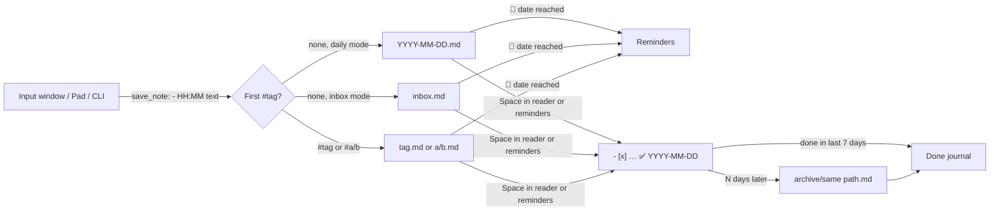

# Overview

Quicklly is a hotkey notepad for Windows. A global hotkey brings up a one-line input window over
every other window; the typed thought is appended with the time to a Markdown file and the window
disappears, so the user stays in the task at hand. Around that core the application offers a
larger editor (the Pad), a reader for browsing, completing, editing and deleting notes, search,
tags, due dates with reminders, an archive of completed notes and a journal of recent work. All
data lives in plain Markdown files in a folder the user chooses. This page states the purpose,
the principles that shape every change, the scope and the direction of the project.

## Purpose

The design target is the time from a thought to a saved note: about two seconds, with no mouse
and no context switch. Everything else (reading, organising, reminding) exists to make the notes
captured that way useful later, without turning the application into a general note-taking
system.

## Product principles

| Principle | What it means in practice |
| --- | --- |
| Keyboard first | Every window is fully usable from the keyboard. Windows open focused where the user works (on the monitor with the active window) and close with <kbd>Esc</kbd> or <kbd>Ctrl</kbd>+<kbd>C</kbd>. The mouse works but is never required. |
| Plain Markdown files the user owns | Notes are ordinary UTF-8 `.md` files in a user-chosen folder. There is no database, no cache of note content and no hidden metadata. The files can be edited by hand, synced with OneDrive or Git, and read by other tools; the application tolerates hand edits. See [Data format](data-format.md) and [ADR 0002](decisions/0002-plain-markdown-files-as-the-only-storage.md). |
| Obsidian-compatible formats | Formats are chosen so that Obsidian renders the files correctly: done notes are Markdown tasks, due and done dates use the Obsidian Tasks emoji format, images are standard Markdown image links relative to the note file. See [ADR 0004](decisions/0004-obsidian-tasks-formats-for-due-and-done-dates.md). |
| Simplicity over guardrails | The simplest implementation wins. There are no input restrictions and no heuristics that guess the user's intent or the state of the outside world; the user decides. For example, `#tag` routing follows a fixed grammar rather than guessing, and a hotkey that cannot be registered is reported rather than replaced. |
| Minimal settings | A setting is added only where users genuinely differ (folder, file layout, date format, appearance). Behaviour that can have one good default has no setting. |
| Lightweight | The application lives in the tray, creates windows only when they are first needed, and keeps its installer small. See [ADR 0001](decisions/0001-tauri-2-over-electron.md) and [ADR 0008](decisions/0008-windows-created-lazily-from-async-commands.md). |
| Safe changes to user data | Destructive operations go to the Recycle Bin, edits only touch the note the user saw and are refused if the file changed, and changes made in the reader can be undone. See [ADR 0010](decisions/0010-reader-changes-guarded-by-the-note-as-last-seen.md) and [ADR 0015](decisions/0015-deletions-go-to-the-recycle-bin.md). |

## Scope

In scope:

- Capturing notes: the input window, the Pad, pasted images, tags, dates, saving from scripts and
  `quicklly://` links.
- Working with notes: the reader (complete, edit, delete, undo, copy links, open images), search,
  reminders for due notes, the archive of completed notes and the journal of the last seven days.
- Running unobtrusively: tray icon, global hotkey, start with Windows, signed automatic updates.

The application currently targets Windows only. It relies on WebView2, the acrylic window effect,
the Windows Recycle Bin and Win32 calls for the active window and the console.

## Non-goals

- A database, an index or any storage other than the Markdown files.
- Account, cloud service or built-in sync; syncing is left to the user's tools.
- Rich text editing or Markdown rendering beyond highlighting links, tags, dates and images.
- Organisation through commands such as `/todo` or `/link`; organisation goes through `#tags`, and
  `/` commands control the application only.
- Capturing screenshots; images are pasted from the clipboard.
- Animations and automatic "what's new" pop-ups.
- Capturing text selected in the active window. This was prototyped and dropped: it required
  simulating <kbd>Ctrl</kbd>+<kbd>C</kbd> and restoring the clipboard.

## Direction

The following describes the intended direction at a high level. It is not a commitment to scope
or dates.

- **Version 1.0** is planned to include reminders at a time of day (a Windows notification for a
  note such as "tomorrow at 10 call the bank", extending the day-based dates and reminders),
  publication in winget, screenshots in the README, and ports to macOS and Linux.
- **macOS and Linux ports.** The build matrix would cover all three platforms with one update
  manifest. Known porting work: vibrancy instead of acrylic on macOS; an X11 global hotkey on
  Linux, while on Wayland applications cannot register global hotkeys, so a command that the user
  binds in the desktop environment (or the `GlobalShortcuts` portal) would replace it; a tray
  through AppIndicator; fallback monospace fonts; layout checks in WebKit. Restoring images from
  the Recycle Bin uses `trash::os_limited`, which is not available on macOS and would need a
  platform guard.
- **Backlog ideas**, not scheduled: capturing context with a note (active window, browser URL),
  writing into an Obsidian vault's daily note, voice input, LLM-assisted triage of the inbox, Git
  sync.

## Note lifecycle

Details of each step are in [Data format](data-format.md) and the [window pages](windows/README.md).
