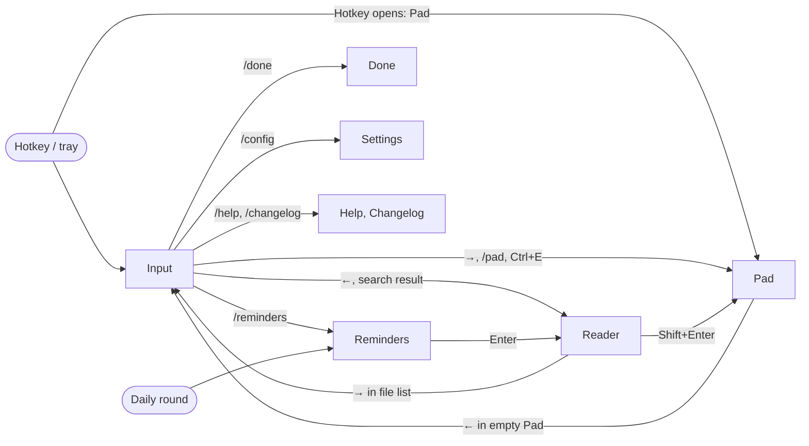

# Windows

Quicklly has eight windows. Each one is a page in its own folder under
[`src/windows/`](../../src/windows/) with Rust code that creates and places it. The pages below
describe, for each window, its responsibilities, files, keys, the commands it uses, and its
notable behaviour and edge cases. Window creation, focus rules and the full command and event
lists are in [Architecture](../architecture.md).

| Window | Label | Kind | Page |
| --- | --- | --- | --- |
| Input window | `main` | Hidden between uses | [input.md](input.md) |
| Pad | `pad` | Hidden between uses; can be pinned | [pad.md](pad.md) |
| Reader | `reader` | Popup, closed when dismissed; can be pinned | [reader.md](reader.md) |
| Reminders | `reminders` | Corner popup, shown without focus | [reminders.md](reminders.md) |
| Done journal | `done` | Popup | [done.md](done.md) |
| Settings | `settings` | Popup | [settings.md](settings.md) |
| Help, Changelog | `help`, `changelog` | Popups | [help-and-changelog.md](help-and-changelog.md) |

